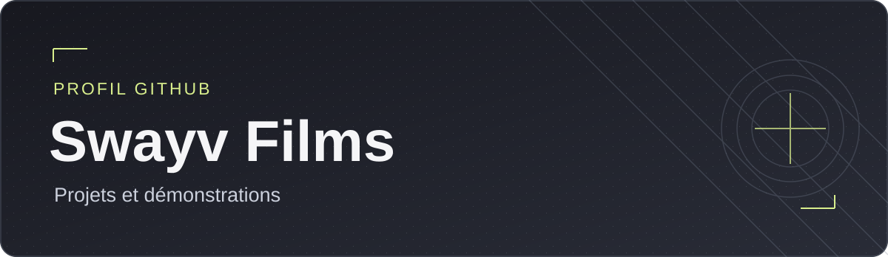

[**Accéder au portfolio de Walid Boussaha ↗**](https://github.com/walidboussaha) · [Lancer les démos web](https://walidboussaha.github.io/runtrack-html/)

Ce compte accompagne mon profil principal, **@walidboussaha**, où je présente mes réalisations à La Plateforme_.

## À découvrir

- **BloomPetals et CV web** · [Deux démos HTML et CSS](https://walidboussaha.github.io/runtrack-html/)
- **Runtrack Python** · [62 exercices et leurs points d’entrée](https://github.com/walidboussaha/runtrack-python)
- **Git Begins** · [Mémo des commandes de versionnage](https://github.com/walidboussaha/git-begins)
