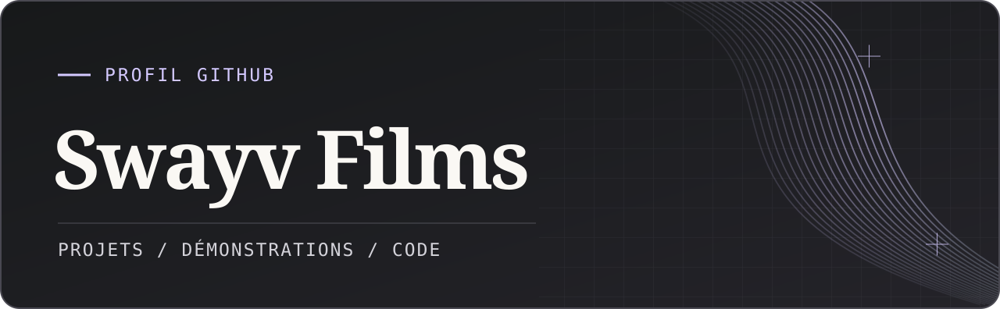

<h1 align="center">Salut, ici Swayv Films ! 🎬</h1>

👤 <b>Compte secondaire de <a href="https://github.com/walidboussaha">@walidboussaha</a></b> | 🎓 <b>Projets réalisés à La Plateforme_</b>

<i>Démos web | Python | HTML | CSS | Git | JavaScript (en cours)</i>

  

  

Bienvenue ! Ce compte présente les projets de Walid Boussaha, à ouvrir en un clic. Le code complet est sur [@walidboussaha](https://github.com/walidboussaha).

---

## 🛠️ Technologies et outils

  

---

## 🍿 À l’affiche

<table>
  <tr>
    <td width="55%" valign="top">
      
    </td>
    <td width="45%" valign="top">
      <h3>🌸 BloomPetals</h3>
      
Site vitrine de fleuriste en quatre pages, en HTML et CSS.

      
<a href="https://walidboussaha.github.io/runtrack-html/BloomPetals/">Ouvrir le site ↗</a>

      <h3>📄 CV web</h3>
      
Page responsive avec intégration vidéo.

      
<a href="https://walidboussaha.github.io/runtrack-html/CV/mon-cv.html">Ouvrir le CV ↗</a>

      <h3>🐍 Runtrack Python</h3>
      
62 scripts, avec un guide et des exemples de tri et de manipulation de chaînes.

      
<a href="https://github.com/walidboussaha/runtrack-python">Voir le dépôt</a>

      <h3>🌱 Git Begins</h3>
      
Premiers exercices de versionnage.

      
<a href="https://github.com/walidboussaha/git-begins">Voir le dépôt</a>

    </td>
  </tr>
</table>

---

## 📈 Activité de @walidboussaha

  
  

  

---

## 🌟 Restons en contact !

  
  

---

## 🎉 Fun fact

Le site BloomPetals tient en quatre pages HTML et une seule feuille de style. 🌸

---

## 😂 La blague du jour

  

---

## 📺 Mon temps libre

  

