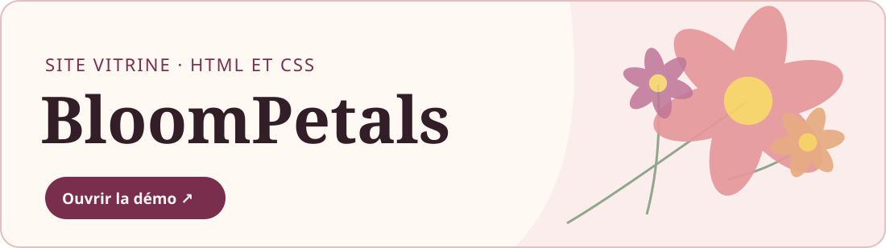

<h1 align="center">🎬 Swayv Films</h1>

  

  
  
  

---

## 🎞️ Le pitch

Ce compte est la vitrine de **Walid Boussaha**. Le code vit sur [@walidboussaha](https://github.com/walidboussaha). Ici, tu trouves la bande-annonce : trois projets réalisés à **La Plateforme_**, à ouvrir en un clic.

## 🍿 À l’affiche

<table>
  <tr>
    <td width="55%" valign="top">
      
    </td>
    <td width="45%" valign="top">
      <h3>🌸 BloomPetals · Web</h3>
      
Site vitrine de fleuriste en quatre pages, en HTML et CSS.

      
<a href="https://walidboussaha.github.io/runtrack-html/BloomPetals/">Ouvrir le site ↗</a>

      <h3>📄 CV web · Web</h3>
      
Page responsive avec intégration vidéo.

      
<a href="https://walidboussaha.github.io/runtrack-html/CV/mon-cv.html">Ouvrir le CV ↗</a>

      <h3>🐍 Runtrack Python</h3>
      
62 scripts, avec un guide et des exemples de tri et de manipulation de chaînes.

      
<a href="https://github.com/walidboussaha/runtrack-python">Voir le dépôt</a>

      <h3>🌱 Git Begins</h3>
      
Premiers exercices de versionnage.

      
<a href="https://github.com/walidboussaha/git-begins">Voir le dépôt</a>

    </td>
  </tr>
</table>

## 🎬 Au casting

  

## 📈 Activité du compte principal

  
  

---

🎥 Fin de la bande-annonce. Le film complet est sur <a href="https://github.com/walidboussaha">@walidboussaha</a>.

